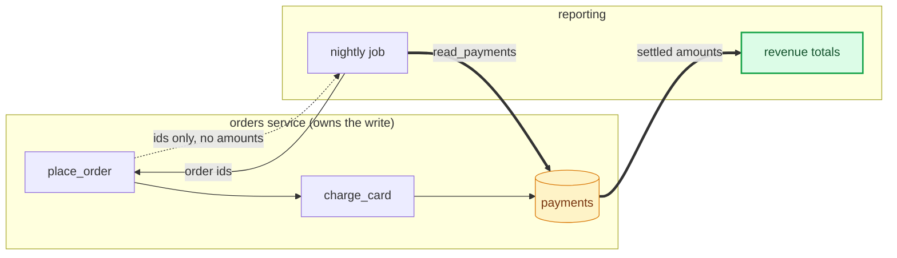

## When
A Mermaid block is about to be written for a change or a design. Whether to draw at all: `engines/write.md` "Diagram decision". Callers: `change-write` and the plan skills.

## Inputs
The one-line question the diagram answers, and what changed.

## Differs
The type, palette, syntax and render check below. A reviewer given the old arrow and the new one can object to the routing, which is the part worth objecting to.

**Type follows what changed, not habit.**

| What changed | Type |
|---|---|
| Order of calls between services | `sequenceDiagram` |
| Where data comes from or lands | `flowchart` |
| Branching or control flow | `flowchart TD` |
| A state machine | `stateDiagram-v2` |
| Tables, columns, relations | `erDiagram` |
| Which component owns what | C4-style `flowchart` with subgraphs |

A request and its response drawn as two flowchart arrows is a sequence diagram written wrong.

**Every node is a component, a store or a call. Never a sentence.** No box saying
`before: completion counts only`, no box listing the metrics the description already lists. Prose in
a box is the description leaking into the picture, and it is the most common way one of these goes
wrong. Old state belongs in a second diagram or nowhere.

**Colour carries the meaning. Grey boxes are a defect.** A reviewer should find the change without
reading a label. Paste this palette into every diagram and use only the classes it needs. Each class
sets `fill`, `stroke` *and* `color`: the source control host's dark themes draw default text light, so a pale fill
without an explicit dark `color` renders unreadable.

```
classDef new      fill:#dcfce7,stroke:#16a34a,stroke-width:2px,color:#14532d
classDef changed  fill:#dbeafe,stroke:#2563eb,stroke-width:2px,color:#1e3a8a
classDef old      fill:#f3f4f6,stroke:#9ca3af,stroke-dasharray:4 3,color:#4b5563
classDef refused  fill:#fee2e2,stroke:#dc2626,stroke-width:2px,color:#7f1d1d
classDef store    fill:#fef3c7,stroke:#d97706,color:#78350f
classDef external fill:#ede9fe,stroke:#7c3aed,color:#4c1d95
```

| Class | Means |
|---|---|
| `new` | added by this change |
| `changed` | exists, behaves differently now |
| `old` | the path this change removes or bypasses (before-diagram only) |
| `refused` | an error, a denial, a leak: the thing the change is about |
| `store` | a database, bucket, `localStorage`: draw it as `[(name)]` |
| `external` | a peer, a third party, anything outside our trust boundary |

Unchanged nodes stay unclassed. If more than half the nodes carry a class, the diagram is showing
everything and highlighting nothing, cut nodes until it isn't.

**Edges carry weight too.** `==>` for the new path, `-.->` for the removed one, `-->` for the rest.
Put the call or the data on the label. Never `linkStyle` with edge indexes, add an edge above it
later and it styles the wrong ones.

**Subgraphs are owners or trust boundaries**, never decoration. Label them with the repo or the
boundary (`"peer, outside our trust"`) and tint the one that matters:
`style peer fill:#faf5ff,stroke:#7c3aed,color:#4c1d95`.

**A before/after pair (only when the bug is a route):** Two blocks titled **Before** and
**After**, same node ids, same layout direction, so the eye diffs them. The before-diagram shows the
defect in `refused`; the after-diagram shows the fix in `new`. A reviewer who sees the leak drawn in
red on the left understands the change before reading a line of it.



Five nodes, all real. Subgraphs name the owner. Edge labels carry the call and what comes back.
Green is the new path, amber the store it reads. It answers "where do the totals come from now" and
nothing else.

**Syntax essentials.** The rules above decide whether and which; these keep the block parsing.

- Fence as ```mermaid. Start with the type line (`sequenceDiagram`, `flowchart TD`, `stateDiagram-v2`, `erDiagram`).
- Sequence: `autonumber`, then `A->>B: call`, `B-->>A: reply`, `A->>A: self-call`, `Note over A,B: text`. Participants are `participant A as service`, `actor U as user`. A `;` inside a note or message breaks the parse; write a comma.
- Flowchart: `A[box]`, `A[(store)]`, `A{decision}`, `A(["terminal"])`; edges `-->`, `==>`, `-.->` with `|label|`. Quote any label holding brackets, parentheses, colons or a slash: `A["calls /x (async)"]`. `subgraph id["label"]` ... `end` groups by owner.
- State: `[*] --> Idle`, `Idle --> Running: start`. ER: `ORDER ||--o{ LINE : has`, with attributes in a block.
- Node ids are single words with no spaces or reserved words (`end`, `graph`). Keep ids identical across a before and after pair.
- Theme and colour go through `classDef` as above or a config file passed with `-c`. In an HTML page the source sits in `<pre class="mermaid">` with `<`, `>` and `&` escaped.

Render it before it ships, in **both** themes, and look at the images. An unrendered Mermaid block
with a syntax error is worse than no diagram, and a diagram that only reads in light mode is half a
diagram. `npx -y @mermaid-js/mermaid-cli -i d.mmd -o d-light.png -t default -b white` and again with
`-t dark -b '#1f1f1f'`. If `npx` fails on your registry config, use the public registry. If that can't run, load mermaid.js from cdn.jsdelivr.net in a scratch HTML
page, and screenshot it with playwright. Check: every label legible, the coloured nodes are the
change, nothing overlaps.

## Output
The Mermaid block or blocks, plus the light and dark render paths. A UI change adds the playwright screenshot, beside the design frame when the ticket links one, with no verdict written.
